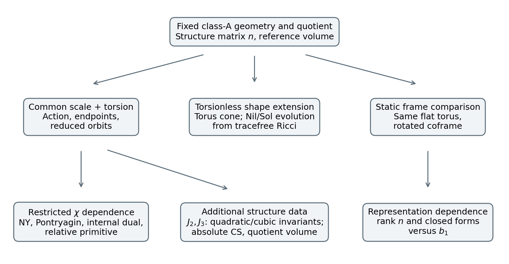

# 1. 導入

**Muacca — Version 2、2026-11-07。初版：2026-05-16。**

## 要旨

固定した $`T^3`$ 、Nil、Sol、 $`S^3`$ のコンパクト参照幾何について、定数の完全Nieh–Yan結合を持つLorentzian Einstein–Cartan作用を比較する。共通scale・二振幅族ではtorsionが補助場として消え、 $`\chi`$ が縮約軌道と指定曲率スカラーを整理する。全接続方程式と五方向のshape変分を合わせ、実の共通scale真空族が局所flatな静的族であることを示す。flat torusでは純粋scale接方向の二次障害を混合scale–shear拘束錐へ拡張し、その各方向を厳密な局所真空解族で実現する。Nil・Solの初期tracefree Ricciはshapeの二次発展とscaleの四次のずれを決める。選定二次・三次曲率縮約は $`\chi`$ に加えて $`J_2,J_3`$ を必要とし、これらは一点の空間Ricciスペクトルを復元する。構造行列の逆問題の退化枝、同じflat torusの大域frame、端点代表の正準対応を導き、縮約軌道・完全真空解・構造表示・境界データの役割を明確にする。

Lorentzian Einstein–Cartan重力の斉次縮約では、同じ作用から得られる局所曲率量、空間積分、縮約軌道、完全な場の方程式を区別する必要がある。本稿は $`T^3`$ 、Nil、Sol、 $`S^3`$ を固定した参照幾何として比較し、空間曲率の指標 $`\chi`$ がどこまで結果を整理するかを調べる。曲率二乗項、matter、宇宙項は導入せず、完全Nieh–Yan（NY）結合を定数とする。基本的なECおよびNYの規約は[Hehl1976, NiehYan1982]を参照する。

基本となる族は、一定のclass A構造行列を持つ空間計量に、一つの時間依存scaleと二つの幾何学的torsion振幅を加えたものである。NilとSolには本来異方的な空間曲率がある。「一様scale」は全方向を同じ比率で拡大する意味であり、空間計量が等方的であることを意味しない。 $`\chi`$ は規格化した参照計量の指標であり、一般の位相不変量ではない。

先行研究[paper1–paper3ec]は、縮約potential、曲率恒等式、斉次変形、torsion変分を扱う。Paper04は四つの固定コンパクト商における構造行列・二次形式・境界量を、Paper05は物理半径で規格化した球面のLorentzian作用・端点変分・斉次変分を論じた。本稿では、一定class A構造行列の曲率公式を導き、四幾何の縮約軌道と完全な場の方程式を比較する。

## 主な結果

完全NYを端点へ分離すると、二つのtorsion振幅は一意に零となる補助場である。残るlapse拘束は $`\chi`$ の符号によって実軌道を分類する。球面では実拘束面が空、torusでは正の定数scale、NilとSolでは固有時間に線形な二方向の軌道となる。ただしNilとSolの軌道には非零の空間tracefree Einstein残差があり、完全なsource-free真空解ではない。

任意時間profileでのNY、Pontryagin、共変な内部双対量と相対Pontryagin primitiveを導く。この族では、それらの局所スカラー式に構造行列が $`\chi`$ を通じて現れ、静的MX内部量の係数は $`C=-9\chi`$ となる。絶対CS primitive、空間tracefree Ricci、積分量の体積は、スカラー曲率に加えて必要となる幾何情報を示す。

比較の構成。torsionを含む共通scale族、torsion消去後のshape拡張、静的frame比較はそれぞれ異なる適用域を持つ。共通scale族の中で、 $`\chi`$ で決まる量と、 $`J_2,J_3`$ や商のデータを必要とする縮約を分ける。

第2節で幾何を固定し、第3–4節で作用・端点・縮約軌道を導く。第5節は共通scaleの成立条件とshape発展、第6節は動的曲率・選定不変量・相対端点量、第7節は $`\chi`$ による整理の範囲を扱う。付録は規約換算、曲率恒等式、変分と再現方法を補う。

## 比較の範囲

本稿の主線は、共通scale縮約の成立条件とshape方向への拡張、および $`\chi,J_2,J_3`$ が保持する曲率情報である。共通scale・二振幅族の公式とは別に、torsion消去後の五つの斉次shape方向を変分する。torusでは純粋scale接方向に二次障害があるが、scaleとshearの混合拘束錐の各方向を厳密真空解族が実現する。Nil・Solでは残差が初期shape加速度とscaleの四次係数を決める。

左不変計量の曲率はMilnorの枠組み、厳密解族はKasner関係式に接続する[Milnor1976, Kasner1921]。線形化された解の積分可能性は一般相対論で既知の問題である。閉じたflat torusは線形化不安定性の標準例であり[BrillDeser1973]、平均曲率一定のコンパクトCauchy面とKilling場を持つ真空時空は解空間の錐状点となる[FischerMarsdenMoncrief1980, ArmsMarsdenMoncrief1982]。本稿ではその一般論を適用する代わりに、固定格子上の有限次元斉次sectorについて必要条件と十分性を直接示す。第5節と付録Dにshape解析、第6–7節と付録Bに不変量と逆問題を置く。

[論文の入口](README_ja.md) / [参考文献](REFERENCES.md)
