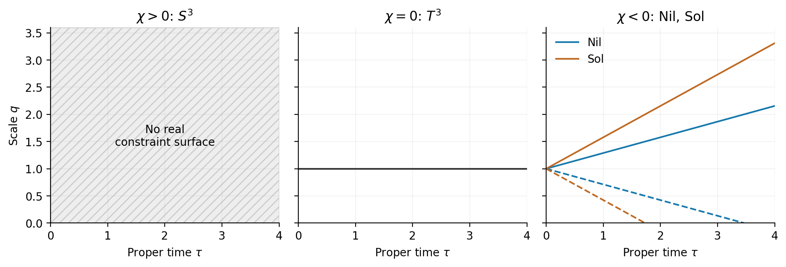

# 4. 補助場拘束と縮約軌道

 $`L_0`$ を変分し、lapseの変分後に時間gaugeを選ぶ。Poisson括弧を $`\lbrace q,p_q\rbrace=1`$ と定めると、canonical変数とHamiltonian拘束は次の形になる。

式(H-01)。

$$
\begin{aligned}
p_q&=-2A_{\Sigma}q\dot q/N,\qquad p_N=p_{\eta}=p_V=0,\\
H_0&=N\mathcal C,\qquad
\mathcal C=-\frac{p_q^2}{4A_{\Sigma}q}-A_{\Sigma}qF,\\
\dot p_N&=-\mathcal C,\qquad
\dot p_{\eta}=A_{\Sigma}Nq\partial_{\eta}F,\quad
\dot p_V=A_{\Sigma}Nq\partial_VF.
\end{aligned}
$$

式(H-02)。

$$
\partial_{\eta}F=-2\eta,\qquad \partial_VF=\frac{2q^2V}{9},\qquad
F_{(\eta,V)(\eta,V)}=\begin{pmatrix}-2&0\\
0&2q^2/9\end{pmatrix},\qquad
\det=-\frac{4q^2}{9}.
$$

 $`q>0`$ では補助場解は一意に $`\eta=V=0`$ であり、NY結合への条件を必要としない。等価な四拘束 $`(p_{\eta},p_V,\eta,V)`$ の括弧行列は非退化である。負のHessian行列式は補助的二次形式のsaddleを示すが、伝播モードの不安定性を意味しない。EH、AX、VT、MXは入力族を区別する名称であり、shell上では同じtorsionless配置へ合流する。

式(H-03)。

$$
\lbrace \phi_I,\phi_J\rbrace =
\begin{pmatrix}0&0&-1&0\\
0&0&0&-1\\
1&0&0&0\\
0&1&0&0\end{pmatrix},\qquad
\phi=(p_{\eta},p_V,\eta,V),\qquad \det\lbrace \phi_I,\phi_J\rbrace =1.
$$

補助場を消去すると、lapse式と半径式は同時に次を与える。ここから固有時間 $`\tau`$ を用いる。

式(H-04)。

$$
\begin{aligned}
F_{\ast}&=\chi,\qquad (Dq)^2+\chi=0,\\
2qD^2q+(Dq)^2+\chi&=0,\qquad d\tau=Ndt.
\end{aligned}
$$

| 条件 | 縮約軌道 | 意味 |
| --- | --- | --- |
| $`\chi>0`$ | 実軌道なし | 実拘束面が空 |
| $`\chi=0`$ | $`q=q_0>0`$ | 定数scale |
| $`\chi<0`$ | $`q=q_0\pm\sqrt{-\chi}(\tau-\tau_0)`$ |  $`q>0`$ の区間で二方向 |

式(H-04)は $`D^2q=0`$ を与える。 $`\chi<0`$ ではDqの絶対値が正の定数なので、正則な $`q>0`$ の区間でbounceもrecollapseも起こらない。この結論は解析式から従い、数値走査の不検出に依存しない。 $`q=0`$ はcoframeが非退化であるという仮定の境界であり、ここから完全時空の特異点や延長可能性を判定しない。

固有時間での縮約軌道。 $`q_0=1`$ とし、 $`q>0`$ だけを表示した。破線は縮小方向、実線は拡大方向である。Nil・Solは縮約作用の停留曲線であり、第5節の除外方程式を満たさない。

torusでは消去後の拘束 $`\mathcal C=-p_q^2/(4A_{\Sigma}q)`$ の勾配が $`p_q=0`$ 上で零となる。この拘束表示は非正則であり、通常の正則拘束の次元公式の前提を満たさない。一方、Euler方程式からは正の定数scaleという解が直接得られる。

時間再パラメータ化の整合性は、off-shellのEuler恒等式で確認できる。 $`L_0`$ の全変数を含む速度Hessianはrank 1であり、非零成分はscale速度の成分だけである。このrankを完全場理論の自由度数とは解釈しない。

式(H-05)。

$$
\begin{aligned}
E_z&=\partial L_0/\partial z-d(\partial L_0/\partial\dot z)/dt,\\
\dot qE_q+\dot\eta E_{\eta}+\dot V E_V-N\frac d{dt}E_N&=0,\\
\frac{\partial^2L_0}{\partial\dot z\partial\dot z}
&=\mathrm{diag}(-2A_{\Sigma}q/N,0,0,0),\qquad z=(q,N,\eta,V).
\end{aligned}
$$

## Torusの純粋scale方向

$`\chi=0`$ 、 $`q_0>0`$ の静的解のまわりで $`q=q_0+\epsilon u`$ とし、lapseを変分してから $`N=1`$ を選ぶ。式(V-01)の一次・二次係数は次になる。 $`E^{[k]}`$ は $`\epsilon^k`$ の係数を表す。

式(H-06)。

$$
\begin{aligned}
E_q^{[1]}&=2A_{\Sigma}q_0\ddot u=0,& E_N^{[1]}&=0,\\
u&=a_u+b_u\tau,& E_N^{[2]}&=A_{\Sigma}q_0 b_u^2=0.
\end{aligned}
$$

したがって局所一次方程式の時間比例方向は二次で排除される。固定両端のscale変分では一次段階ですでに $`a_u=b_u=0`$ である。固定格子で $`q_0`$ は体積modulusであり、時間再パラメータ化のgaugeではない。端点を固定する時間変換の下で固有時間長 $`T=\int Ndt`$ は不変であり、固定 $`T`$ で積分が零のlapse変分はgaugeである。付録Cの可逆変数変換と端点代表の変更でも拘束の非正則性は残る。shapeを許した接方向は第5節で扱う。

[論文の入口](README_ja.md) / [参考文献](REFERENCES.md)
