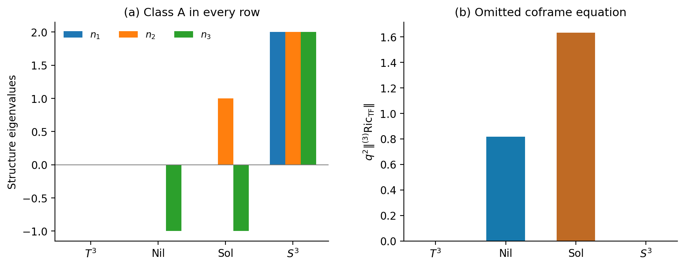
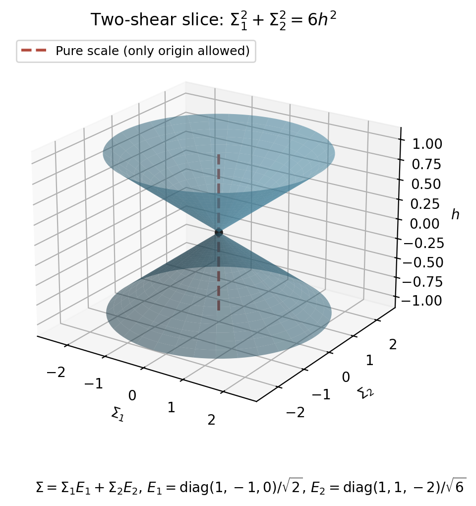

# 5. 共通scale縮約とshape方向の発展

定数結合の完全NYはbulkの接続方程式を変えない。曲率二乗項もspin sourceもないEC作用を独立したmetric-compatible接続で変分すると、次のCartan方程式となる。非退化coframeでは全torsionが零となる。付録Cで二振幅ansatzを使わない証明を示す。

式(E-01)。

$$
\epsilon_{abcd}\thinspace e^c\wedge T^d=0
\quad\Longrightarrow\quad T^a=0.
$$

torsion消去後の完全なcoframe方程式は真空Einstein方程式である。一様scale計量に代入した結果は次のように分かれる。 $`\Xi`$ は空間tracefree Ricciそのものであり、構造行列によって決まる。

式(E-02)。

$$
\begin{aligned}
G_{00}&=3(H^2+\chi/q^2),\qquad G_{0i}=0,\\
G_{ij}&=(-2DH-3H^2-\chi/q^2)\delta_{ij}+\Xi_{ij},\\
\Xi_{ij}&={}^{(3)}\mathrm{Ric}_{ij}-\frac{2\chi}{q^2}\delta_{ij}.
\end{aligned}
$$

式(H-04)を課すと $`G_{00}`$ と空間traceは零になるが、 $`\Xi`$ は残る。対角frameで四幾何の残差は以下のとおりである。

式(E-03)。

$$
q^2\Xi_{T^3}=q^2\Xi_{S^3}=0,\qquad
q^2\Xi_{\mathrm{Nil}}=\tfrac13\mathrm{diag}(-1,-1,2),\qquad
q^2\Xi_{\mathrm{Sol}}=\tfrac13\mathrm{diag}(-4,2,2).
$$

したがって $`T^3`$ の定数scaleは完全真空方程式を満たす。 $`S^3`$ には縮約内でも実軌道が存在しない。Nil・Solの線形軌道は完全真空解ではなく、shapeを固定した変分問題の停留曲線である。これは一般の異方的Nil・Sol時空の真空解を否定するものではない。

四代表点はすべてclass Aである。左は構造行列の固有値、右は空間tracefree RicciのEuclidean normである。実縮約軌道が存在する場合、後者は残るEinstein残差である。球面には実縮約軌道がない。単位scaleのノルムは $`\sqrt{J_2}`$ であり、単位scale残差の反対方向が式(S-03)の初期shape加速度になる。右の量は物理的なmassや不安定性指数ではない。

この作用では、独立接続方程式が全torsionを定め、完全coframe方程式が縮約軌道に残る空間曲率の条件を与える。補助場の代数的消去、実拘束面の存在、完全な場の方程式の成立は、この順に検討できる。

## 共通scale真空族の成立条件

式(E-04)。

$$
\begin{aligned}
f(n)&=\tfrac12(\mathrm{tr}n)^2-\mathrm{tr}(n^2)=6\chi,\\
X(n)&=q^2\Xi=2n^2-(\mathrm{tr}n)n+4\chi I,\qquad \mathrm{tr}X=0,\\
\delta L_{\mathrm{shape}}&=-\frac{N\mathcal V_{\Sigma}q}{\kappa^2}
 \mathrm{tr}(X\delta\mathsf B).
\end{aligned}
$$

式(E-05)。

$$
X=0\quad\Longleftrightarrow\quad n\sim\mathrm{diag}(a,a,a)\ \text{or}\ \mathrm{diag}(a,a,0),\qquad a\in\mathbb R.
$$

ここで $`\sim`$ は定数 $`SO(3)`$ 共役を表す。第一枝では $`\chi=a^2/4`$ なので、非零 $`a`$ に実の共通scale真空軌道はない。第二枝では空間曲率が零、 $`\chi=0`$ で、実真空族は静的である。これは一般実対称 $`n`$ の局所分類であり、新しいcompact quotientの存在を主張しない。五shape方向の変分と固有値による証明は付録Dに示す。

## Flat torusの混合拘束錐

固定格子の $`n=0`$ torusで $`q=q_0e^{\epsilon\rho}`$ 、 $`\mathsf B=\epsilon\mathsf B_1`$ 、 $`N=N_0+\epsilon\delta N`$ とし、 $`\tau=\int N_0dt`$ とおく。二次作用の線形解と、元のlapse方程式の二次係数は次である。

式(S-01)。

$$
\begin{aligned}
L^{[2]}&=\frac{A_{\Sigma}q_0^3}{6N_0}\left[\mathrm{tr}(\dot{\mathsf B}_1^2)-6\dot\rho^2\right],\\
\rho&=\rho_0+h\tau,\qquad \mathsf B_1=\mathsf B_0+\Sigma\tau,\\
\Sigma^T&=\Sigma,\quad\mathrm{tr}\Sigma=0,\qquad \mathrm{tr}(\Sigma^2)=6h^2.
\end{aligned}
$$

$`\Sigma=0`$ なら $`h=0`$ であり、式(H-06)と $`u=q_0\rho`$ で整合する。一方、非零の混合方向は積分可能である。 $`h\ne0`$ の各方向に対して次の固定格子上の厳密計量を構成する。 $`\psi^{2\mathsf P}=\exp(2\mathsf P\log\psi)`$ は正定値である。

式(S-02)。

$$
\begin{aligned}
\mathsf P&=\tfrac13 I+\frac{\Sigma}{3h},\quad M_0=\rho_0I+\mathsf B_0,\quad \psi=1+3\epsilon h\tau>0,\\
g_{\epsilon}(\tau)&=q_0^2e^{\epsilon M_0}\psi^{2\mathsf P}e^{\epsilon M_0},\\
\mathrm{tr}\mathsf P&=\mathrm{tr}(\mathsf P^2)=1,\qquad
q_{\epsilon}=q_0e^{\epsilon\rho_0}\psi^{1/3}.
\end{aligned}
$$

これはKasner型の真空解族であり[Kasner1921]、 $`\epsilon=0`$ の接ベクトルは指定した $`\rho,\mathsf B_1`$ に一致する。任意の有界時間区間で十分小さい $`\epsilon`$ に対して $`\psi>0`$ が共通に成立する。 $`h=0`$ では錐条件から $`\Sigma=0`$ となり、静的な正定値計量moduliが実現する。したがって、この斉次sectorでは錐条件が各一次接方向の局所積分可能性に必要十分である。これはflat torusの線形化不安定性[BrillDeser1973]の斉次版であり、錐は静的な時間並進に伴う二次条件に当たる。 $`n=0`$ ではmomentum拘束が恒等的に零となる（付録D）。固定両端計量を課せば一次のaffine変分はすべて零になる。付録Dは非可換な初期shapeも含めて証明する。

二つの正規直交shear方向を選んだ $`\mathrm{tr}(\Sigma^2)=6h^2`$ の三次元切断。pure-scale軸は原点以外で錐に含まれない。五shape全体や物理自由度空間の図ではない。

## Nil・Solの初期shape発展

対角LC真空sectorで初期値 $`q=q_0`$ 、 $`\beta_i=D\beta_i=0`$ 、 $`H_0^2=-\chi/q_0^2`$ を選ぶ。 $`e^i=qe^{\beta_i}\sigma^i`$ 、 $`\sum_i\beta_i=0`$ とし、 $`\hat\tau=\tau/q_0`$ 、 $`h_{\ast}=H_0q_0`$ とおく。初期 $`X_i`$ と $`J_2=\mathrm{tr}(X^2)`$ は次の厳密Taylor係数を決める。

式(S-03)。

$$
\begin{aligned}
\beta_i&=-\tfrac12X_i\hat\tau^2+\tfrac56h_{\ast}X_i\hat\tau^3+O(\hat\tau^4),\\
q/q_0&=1+h_{\ast}\hat\tau-\tfrac1{36}J_2\hat\tau^4+O(\hat\tau^5).
\end{aligned}
$$

| 幾何 | $`J_2`$ | scaleの $`\hat\tau^4`$ 係数 |
| --- | --- | --- |
| Nil | $`2/3`$ | $`-1/54`$ |
| Sol | $`8/3`$ | $`-2/27`$ |

残差 $`\Xi`$ はshapeの二次発展を、 $`J_2`$ はscaleの直線軌道からの四次のずれを与える。付録Dは閉じたODE、拘束伝播と係数導出を示す。補足資料の両時間向き・計12点の数値対照はこれらの局所係数の対照であり、区間全体の誤差保証や長時間安定性の判定ではない。

[論文の入口](README_ja.md) / [参考文献](REFERENCES.md)
