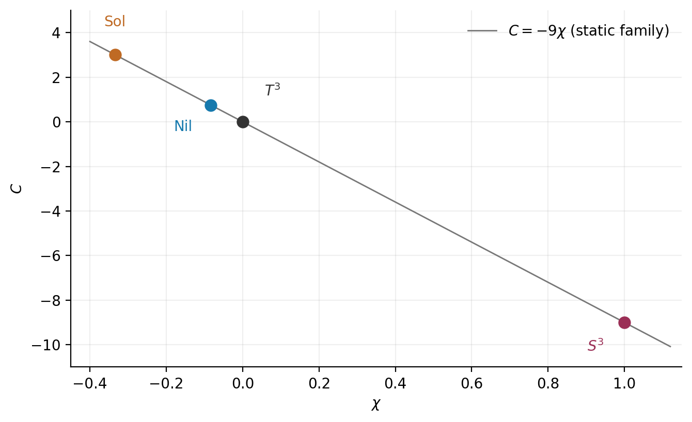
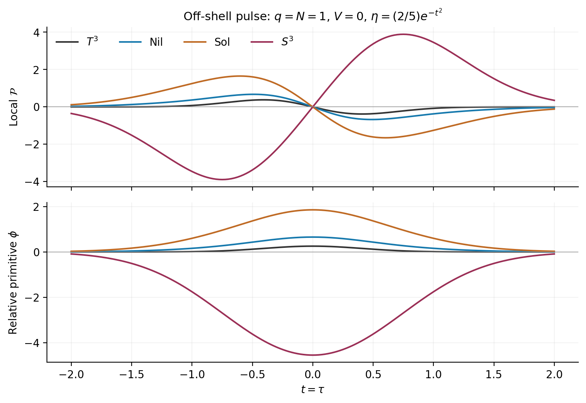

# 6. 時間依存曲率と相対端点量

同じ接続(G-04)の曲率を、静的条件を課す前に求める。三つの空間平面には異なる $`y_i`$ が現れるが、残る三つのblock x,z,wは共通である。

式(D-01)。

$$
\begin{aligned}
R^0{}_{i}&=x e^{0i}+w e^{jk},\qquad R^j{}_{k}=z e^{0i}+y_i e^{jk},\\
x&=Db+Hb,\qquad z=-D\eta/q,\qquad w=2b\eta/q,\\
y_i&=b^2+(k_i-\eta^2)/q^2,\qquad
\bar y=\tfrac13\sum_i y_i=b^2+(\chi-\eta^2)/q^2.
\end{aligned}
$$

Q、完全NY、Pontryaginは向き付けた形式として定義する。内部双対量Bでは形式添字をLorentz計量で上げる。全内部添字を総和する規格化で、直接外積と成分縮約は次を与える。

式(D-02)。

$$
\begin{aligned}
Q&=\frac{6\eta}{q}e^{123},\qquad Q_{\Sigma}=6\mathcal V_{\Sigma}q^2\eta,\\
dQ&=\mathcal N e^{0123},\qquad \mathcal N=6(D\eta+2H\eta)/q,\\
\sum_{a,b}R_{ab}\wedge R^{ab}&=\mathcal P e^{0123},\qquad
\mathcal P=12(\bar y z-xw),\\
\mathcal B&=\tfrac1{16}\epsilon^{abef}R_{abcd}R_{ef}{}^{cd}
=3(w\bar y-xz).
\end{aligned}
$$

空間planeの寄与を足すと $`\sum_i y_i=3\bar y`$ となるため、これらのスカラー式の構造依存は $`\chi`$ だけに集約される。これは一定のclass A構造行列と、共通scale・二振幅torsionという仮定を使う恒等式である。時間依存shapeやtensor torsionを許した一般場の恒等式ではない。BとPは異なる添字対に双対を取るため、同じ量ではない。

| 族 | 局所量 | 端点量 |
| --- | --- | --- |
| 静的 | $`\mathcal N=\mathcal P=0`$ | Qは非零可 |
| 動的AX |  $`\mathcal N,\mathcal P,\mathcal B`$ は一般には非零 | Qは非零可 |
| 動的VT | $`\mathcal N=\mathcal P=\mathcal B=0`$ | $`Q_{\Sigma}=0`$ |
| 動的MX | 式(D-02)で評価 | Qは非零可 |
| 滑らかな補助場shell | $`\mathcal N=\mathcal P=\mathcal B=0`$ | $`Q_{\Sigma}=0`$ |

静的とは $`q,\eta,V`$ の全時間微分が零であることを指す。動的VTでは $`\eta`$ が区間全体で恒等的に零なので $`D\eta`$ も零となる。補助場shellも同じ意味で $`\eta=V=0`$ を課す。ある一時刻で振幅だけが零のprofileはこのshellと同じではない。

式(D-03)。

$$
\left.\mathcal B\right|_{\mathrm{static}}
=\frac{2V\eta}{9q^3}(-V^2q^2+9\eta^2+C),\qquad C=-9\chi.
$$

式(D-03)は共変な内部双対量の静的極限である。AXとVTでは零、MXでは非零となり得る。係数Cは、曲率から求めたBのVη係数を抽出することで得られる。付録Bにその導出を示す。

共変な静的内部双対量から抽出したCと、LC空間曲率から導いた $`\chi`$ の関係。球面は物理半径の規約で $`\chi=1,\ C=-9`$ となる。

時間依存はPontryagin密度にも寄与する。例えば以下のjetは滑らかなoff-shell profileの局所データとして実現でき、球面で $`\mathcal P=-9`$ を与える。

式(D-04)。

$$
q=N=1,\quad \dot q=\ddot q=\dot N=V=\dot V=0,\quad
\eta=\tfrac12,\quad D\eta=1
\quad\Longrightarrow\quad \mathcal P=3-12\chi,\quad \mathcal N=6.
$$

## 絶対primitiveと相対primitive

同じ接続の局所CS形式を用いる。diagonal frameの構造固有値から作る基本対称式を $`s_1,s_2,s_3`$ とすると、直接計算したslice primitiveは以下である。

式(D-05)。

$$
\begin{aligned}
\mathrm{CS}_{\mathcal P}&=-\mathrm{tr}(\omega\wedge d\omega+\tfrac23\omega\wedge\omega\wedge\omega),\\
\int_{\Sigma}\mathrm{CS}_{\mathcal P}&=\mathcal V_{\Sigma}(\Phi_0+\phi),\\
\Phi_0&=s_1^3-4s_1s_2+10s_3,\qquad
s_1=\sum_i n_i,\quad s_2=\sum_{i\lt j}n_in_j,\quad s_3=n_1n_2n_3,\\
\phi&=-12\chi\eta+4\eta^3-12\eta q^2b^2,\qquad
D\phi=q^3\mathcal P.
\end{aligned}
$$

 $`\Phi_0`$ は指定した斉次frameにおけるLC参照値であり、 $`T^3`$ 、Nil、Sol、 $`S^3`$ でそれぞれ0,−1,0,8となる。固定構造の時間区間では定数なので端点差から消えるが、 $`\chi`$ だけではその値を決められない。局所framingを変更した絶対CS値を不変な電荷と呼ばない。

同じcoframeのLC接続 $`\bar\omega`$ を参照に選び、 $`K=\omega-\bar\omega`$ と置く。二つの接続を同じframe同定で比較する相対形式は次式である。

式(D-06)。

$$
\begin{aligned}
\mathcal T_{\mathcal P}&=-2\mathrm{tr}(K\wedge\bar R)-\mathrm{tr}(K\wedge\bar D K)
-\tfrac23\mathrm{tr}(K\wedge K\wedge K),\\
d\mathcal T_{\mathcal P}&=-\mathrm{tr}(R\wedge R)+\mathrm{tr}(\bar R\wedge\bar R),\\
\int_{\Sigma}\mathcal T_{\mathcal P}&=\mathcal V_{\Sigma}\phi,\qquad
\int_M\mathcal P e^{0123}=\mathcal V_{\Sigma}[\phi]_i^f.
\end{aligned}
$$

この族ではLCのPontryaginが零となるため、相対primitiveの微分はPを与える。同時local Lorentz変換ではK、 $`\bar R`$ 、 $`\bar D K`$ が共役変換し、traceの巡回性により相対形式は不変である。別々の端点frameを無指定で比較することや、量子化を主張することは含まない。NY積分も同様に $`Q_{\Sigma}`$ の向き付き端点差となる。

固定scaleのoff-shell pulse。局所Pは一般に非零だが、偶関数 $`\eta`$ の両端で相対primitiveが等しいため区間積分は零である。密度・端点量・物理的応答を区別する。

## 選定二次・三次縮約

この小節は共通scale・二振幅族に限る。 $`x=Db+Hb`$ 、 $`\bar y=b^2+(\chi-\eta^2)/q^2`$ 、 $`z=-D\eta/q`$ 、 $`w=2b\eta/q`$ を用いる。全添字はLorentz計量で上げ下げする。EC曲率の添字対交換対称性は仮定しない。

式(I-01)。

$$
\begin{aligned}
J_2&=\mathrm{tr}(X^2),& J_3&=\mathrm{tr}(X^3),\\
I_1&=R_{abcd}R^{abcd},& I_2&=R_{abcd}R^{cdab},\\
I_{\mathrm{Ric}}&=\mathrm{Ric}_{ab}\mathrm{Ric}^{ab},&
C_{\mathrm{Ric}}&=\mathrm{Ric}^a{}_b\mathrm{Ric}^b{}_c\mathrm{Ric}^c{}_a,\\
C_R&=R_{ab}{}^{cd}R_{cd}{}^{ef}R_{ef}{}^{ab}.&&
\end{aligned}
$$

$`C_R`$ は各添字を全順序付きで和を取る定義であり、二形式上の作用素に付ける $`1/2`$ 因子を含めない。曲率blockから直接、次を得る。

式(I-02)。

$$
\begin{aligned}
I_1&=12(x^2+\bar y^2-w^2-z^2)+4J_2/q^4,\\
I_2&=12(x^2+\bar y^2+2wz)+4J_2/q^4,\\
I_{\mathrm{Ric}}&=12(x^2+x\bar y+\bar y^2)+J_2/q^4,\\
I_1-I_2&=-12(w+z)^2.
\end{aligned}
$$

式(I-03)。

$$
\begin{aligned}
C_{\mathrm{Ric}}&=27x^3+3(x+2\bar y)^3
 +3(x+2\bar y)J_2/q^4+J_3/q^6,\\
C_R&=24[x^3+\bar y^3+3wz(x+\bar y)]
 +24\bar y J_2/q^4-8J_3/q^6.
\end{aligned}
$$

式(I-04)。

$$
\left.C_{abcd}C^{abcd}\right|_{\mathrm{LC}}=2J_2/q^4.
$$

最後の式の $`C_{abcd}`$ はLC Weyl tensorであり、ECでのWeyl解釈へ拡張しない。Nil・Solの縮約直線軌道では $`x=\bar y=w=z=0`$ でも $`I_{\mathrm{Ric}}=J_2/q^4\ne0`$ が残る。したがって縮約したスカラーの消失は曲率テンソルの消失を意味しない。付録Bで全縮約とtrace除去を導く。

[論文の入口](README_ja.md) / [参考文献](REFERENCES.md)
